# Redesign report, pass 2: Aramesh Music Academy

The public site was redesigned a second time on the `re-design-ui` branch, following [02-redesign-brief.md](02-redesign-brief.md) (Phases A to E, steps 1–23). The direction is **«سینه به سینه»** ([03-direction.md](03-direction.md)): Persian music is handed down teacher to student, and the site tells that as a short path of framed panels from a real person to the next step. The look is Ethos-led, as the brief pinned it: stone panels on a warm near-black ground, saffron for the one way in, Amiri over Sahel, pills. The system as shipped is in [DESIGN.md](../../DESIGN.md).

This report takes the brief's eight checklist items one at a time, with evidence and before/after screenshots at 1440, 768 and 390 pixels. It ends with measurements, known gaps, and what the owner must do in the admin.

**About the screenshots**
- **Before** (`screenshots/pass1/`) is the site at the end of the first pass, the design this brief replaced: cool paper sheets on a green-black ground, one jade action, Amiri for everything. (The folder was `screenshots/after/` in the first report.)
- **After** (`screenshots/pass2/`) is this pass on the seeded real content, served with `DEBUG=False` and hashed static files, on 2026-10-27. Taken with reduced motion on, so the hero and cards show a still frame rather than a crossfade halfway.
- All are full-page. The Google map is blank in them: the cross-origin iframe doesn't load in the test browser. Programme and Instrument pages are new, so they have no before.

**Branch at a glance:** 118 tests pass. Every model change is one the brief listed or the owner approved at a gate. Nothing has been pushed.

---

## 1. Point of view, not a template

**Verdict: met.**

- **One idea, from the subject.** Every page reads as a path, not a catalogue: Programme → Instrument → the teacher who teaches it → the days they are in → contact. Each teacher is introduced by who taught them, in one line under the name («آموخته نزد هوشنگ ظریف، فرهاد فخرالدینی…»). It passes the competitor test: another academy could copy the panels and pills, but not these teachers and their lineage.
- **One live thing.** «امروز در آموزشگاه» in the hero says who teaches today and until when, from the real ClassSessions in Tehran time. Before the first class it says «از ساعت ۱۲ تا ۲۳»; after the last one, or on a Friday, it says when classes start again. Server-rendered, so it works with no script.
- **Restraint.** One accent, two typefaces, two radii, one saffron field per page (the contact band). The santur shape appears only where a picture is missing and one is still wanted. Instrument tiles with no photo are text alone (owner decision).
- **Checked by:** `/design-taste-frontend`'s inspector ([critique-taste-step16.md](critique-taste-step16.md)), `/impeccable critique`, 24/36 against 19/36 for pass 1 ([critique-step17.md](critique-step17.md)), and the detector. The only pattern it flags is the hero's eyebrow, which the owner pinned.

| Width | Before | After |
|---|---|---|
| 1440 |  | 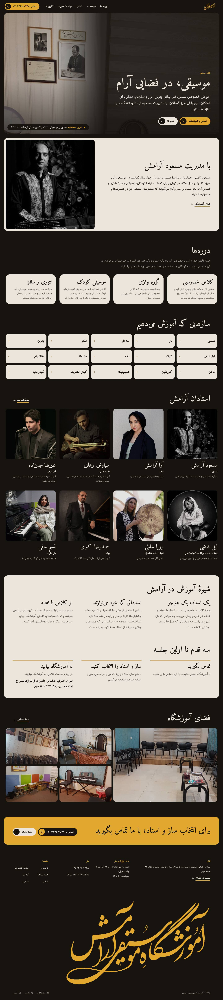 |
| 768 |  | 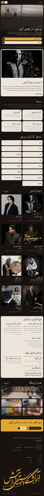 |
| 390 |  | 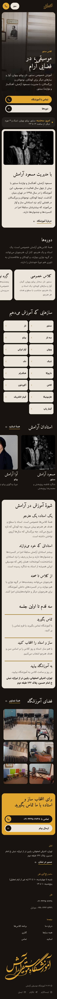 |

## 2. Typography that does work

**Verdict: met.**

- **Amiri 700 for display only** (the page's one `h1`, section heads, card titles and teacher names), **Sahel for everything else** (body 18–20px, nav, buttons, labels, forms). Neither is Inter or Roboto. Tahoma is the fallback because it sits close to Sahel, so the font swap barely moves the text.
- **Self-hosted** subset woff2 with `font-display: swap`; Amiri 700 and Sahel 400/700 only.
- **Persian digits everywhere** come from the font (Sahel FD), including phone numbers and times; `tel:` links keep ASCII digits for the dialler.
- **Built for Naskh:** leading runs inversely to size (1.25 for display, because Amiri's alef-madda and descenders collide below 1.2; 1.85 for body), letter-spacing is 0 at every size because tracking breaks the joins, and the measure is 36em, about 85 Persian characters.
- **Hierarchy by scale and weight:** three Amiri steps (26–36, 32–52, 44–76px) over four Sahel steps (14, 16, 18–20, 20–24px).

| Width | Before | After |
|---|---|---|
| 1440 | 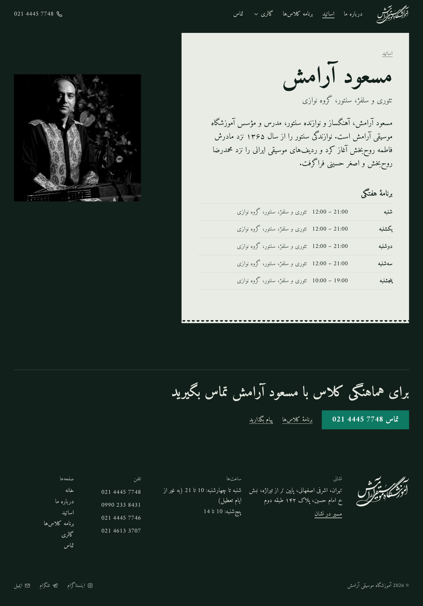 | 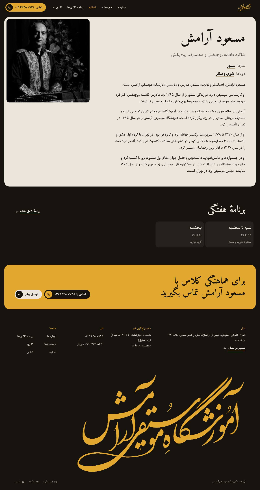 |
| 768 |  | 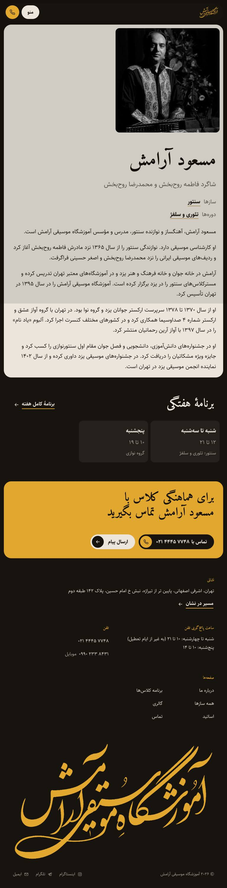 |
| 390 | 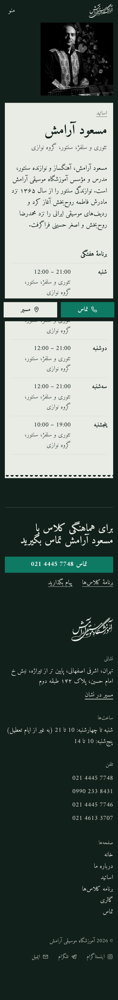 | 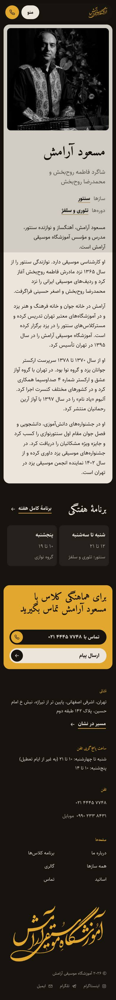 |

## 3. A restrained colour system

**Verdict: met.**

- **Four colours** (ground `#17130f`, stone `#ebe5dc`, saffron `#e2a72e`, error `#a8321f`), plus only the steps contrast needs (raised ground, two soft text tones, field, field line, deep saffron). All are tokens in `site.css`; components read surface roles (`--surface`, `--text`, `--mark`, `--focus`), and a stone panel or the saffron band flips them.
- **Every pair is measured:** stone on ground 14.8:1, ink on saffron 8.6:1, saffron on ground 8.6:1, soft text 6.2–7.6:1. Deep saffron (3.7:1) marks things on stone but is never text.
- **Saffron is rare:** the call pill, current and active states, focus on the ground, today's marker, and one band per page.
- **The hero scrims** mix `var(--ground)`, so a change to the ground carries through.

| Width | Before | After |
|---|---|---|
| 1440 |  | 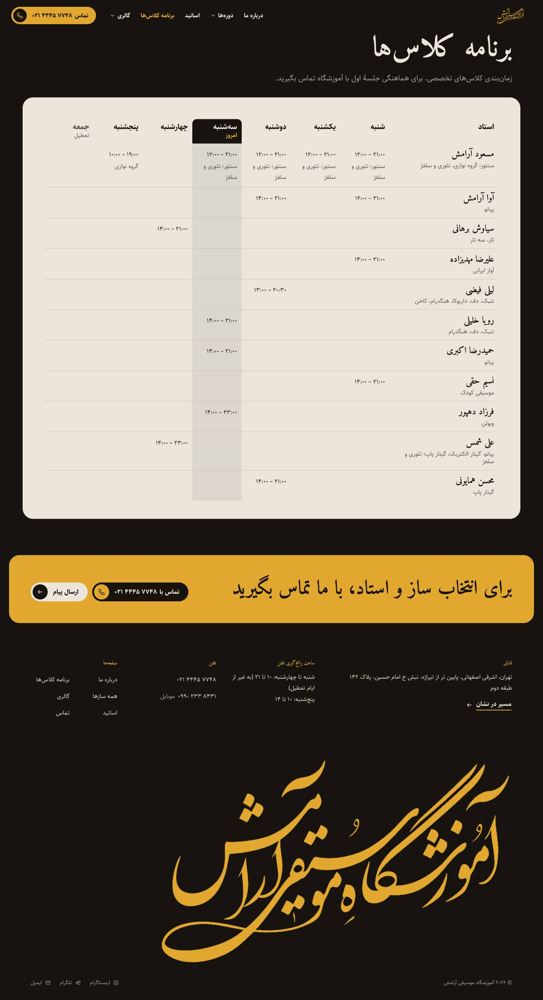 |
| 768 | 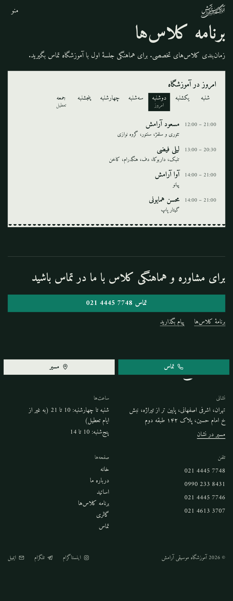 | 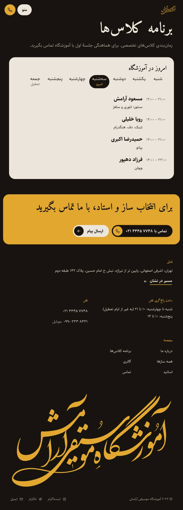 |
| 390 | 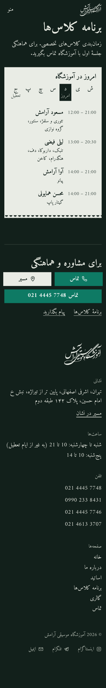 | 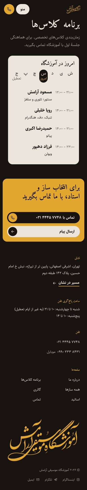 |

## 4. Hierarchy that breathes

**Verdict: met.**

- **One primary per page:** the `h1` in Amiri at 44–76px, then a lead sentence, then section heads, each section in its own panel with `--section` (64–96px) between them and `--panel-pad` (20–64px) inside.
- **Splits put text beside its picture:** the about panel, Programme and teacher heads. A split with no picture sets its name beside its text on wide screens instead of leaving a hole.
- **Sections with no content hide** (testimonials, FAQ, an empty album's grid), so a page never shows an empty block.
- **Pages are paths:** every page ends with a way on, usually the contact band, now cut to its headline and two buttons with the facts kept in the footer (owner decision).
- **Session times read as tiles,** and identical sessions on neighbouring days are listed once («شنبه تا سه‌شنبه، ۱۲ تا ۲۱»). This is worked out on every request, so an hour changed in the admin simply splits the run.

| Width | Before | After (about) | After (a Programme page, new) |
|---|---|---|---|
| 1440 |  | 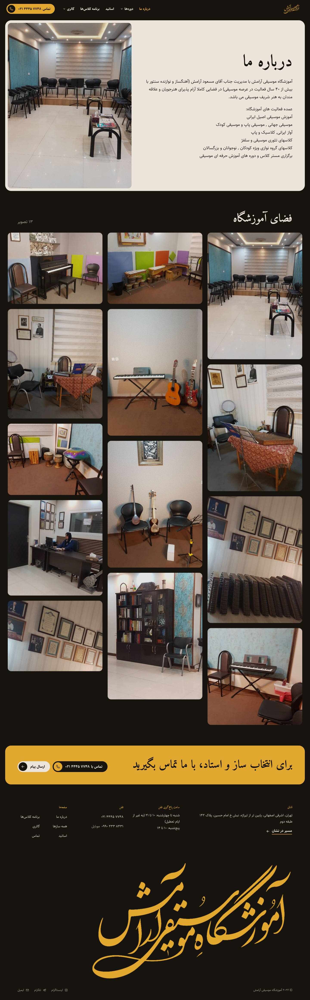 | 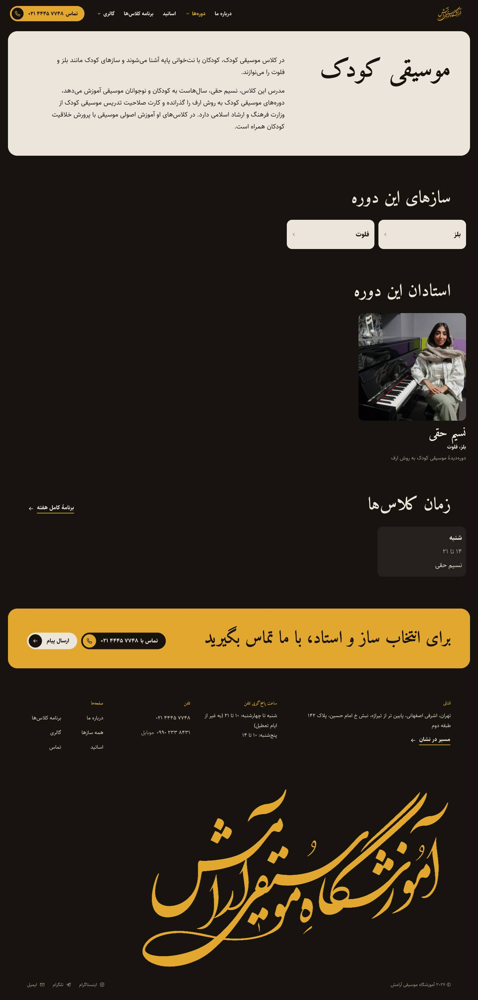 |
| 768 |  | 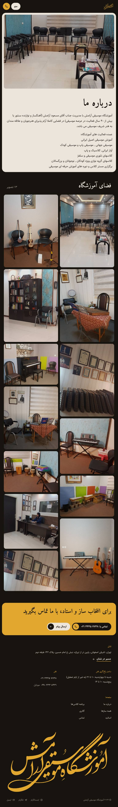 | 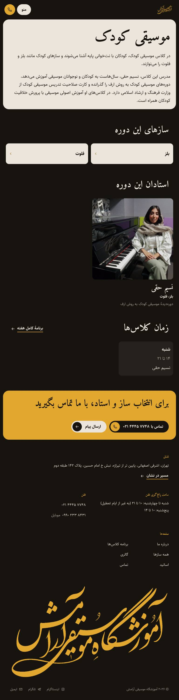 |
| 390 |  | 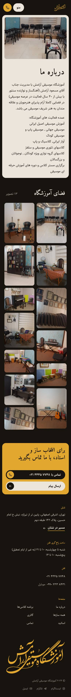 | 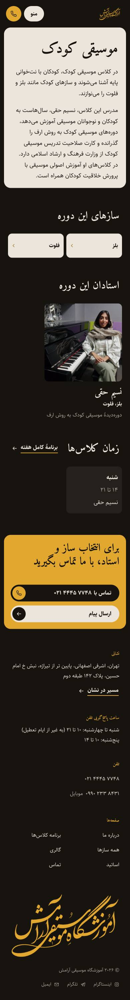 |

## 5. Imagery with intent

**Verdict: met for what exists; the photos the design needs are the owner's to upload.**

- **The real pipeline ratios:** portraits 1:1, Programme and gallery covers 3:2, the hero within 1200px. The hero is framed inside the page margins, never stretched past its pixels.
- **One treatment:** nested rounded frames and a light multiply of the ground, never a filter that changes faces. The hero has a side and bottom scrim, held dark as far as its copy reaches, so its text measures at least 6.4:1 over the brightest wall.
- **Designed fallbacks:**
  - a teacher with no portrait shows their initials in Amiri;
  - an Instrument tile with no photo is its name alone;
  - a Programme card with no photo is its text, set at the foot;
  - an empty album says so and offers the ways on.
- **Sizes stated, fetched when needed:** album photos carry `width`/`height` (CLS 0.1–0.27 → about 0.01). Hidden hero and card photos wait in `data-src` until they are about to show.

| Width | Before | After (rooms album) | After (an empty album) |
|---|---|---|---|
| 1440 | 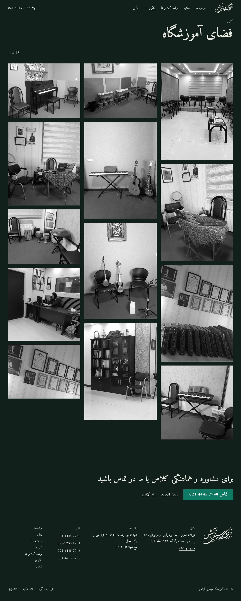 | 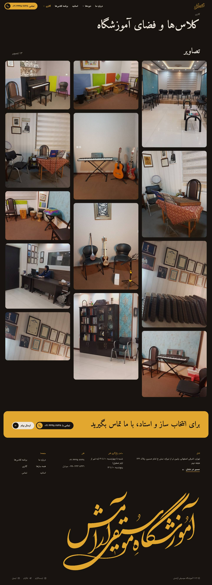 | 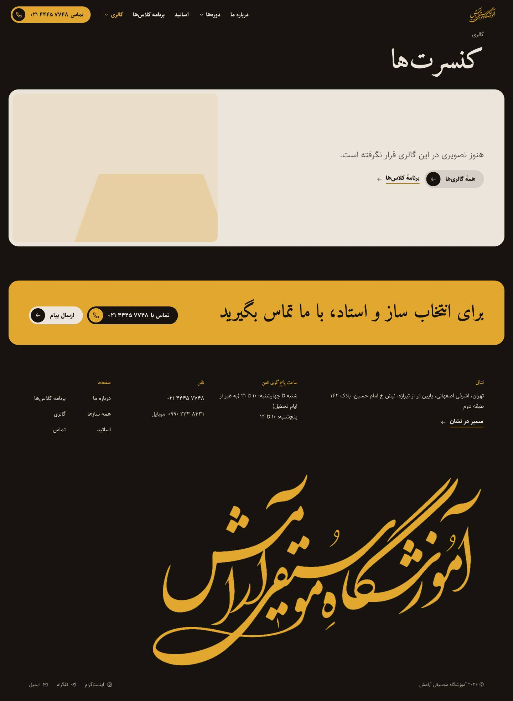 |
| 768 | 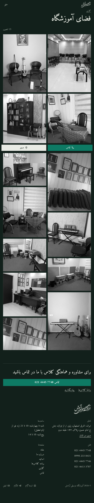 | 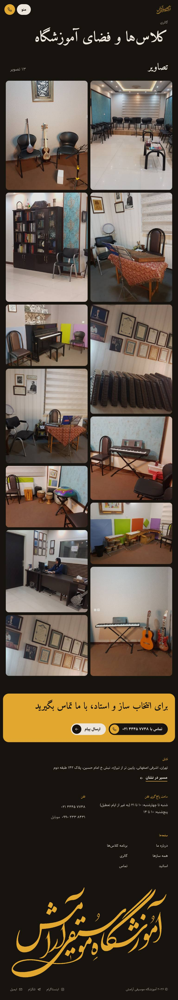 | 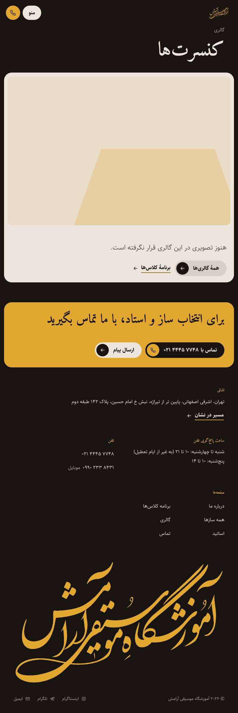 |
| 390 |  | 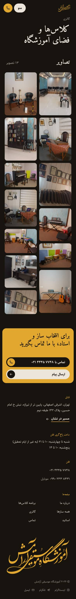 | 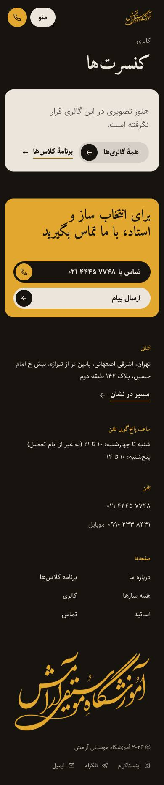 |

## 6. Motion that whispers

**Verdict: met.** Reviewed with `/review-animations` and `/animation-performance` ([motion-step18.md](motion-step18.md)), verdict Approve.

- **Slow where it carries content:**
  - the hero crossfades the `home-hero` photos every 6.5s (1.2s, sine in-out), and its progress bar is the clock;
  - Programme cards crossfade their photos on hover;
  - same-site navigation crossfades through View Transitions, and a teacher's portrait or a Programme's photo travels from its card into the page it opens.
- **Quick where it answers a hand:**
  - presses scale to 0.97 (120ms);
  - the button arrow swaps with its twin and the phone icon tilts (260ms);
  - dropdowns grow from their trigger, and the phone menu and lightbox open in 260ms;
  - the day tabs' ink slides under the chosen day with a clip-path.
- **Interruptible and keyboard-aware:** the lightbox swipe follows the finger and settles on a spring; arrow keys move the day tabs with no animation.
- **Never gating content:** everything is visible on first paint and with no script. Reduced motion zeroes everything that travels, stops the hero and lays the testimonials out still.
- **Inside the frame budget:** with the CPU slowed 4×, the hero crossfade, card hover, day strike and menu sheet show no frame over 17.7ms. Only `transform`, `opacity`, `clip-path` and `background-color` animate, except the FAQ's height.

| Width | Before | After (teachers: cards open into their pages) |
|---|---|---|
| 1440 | 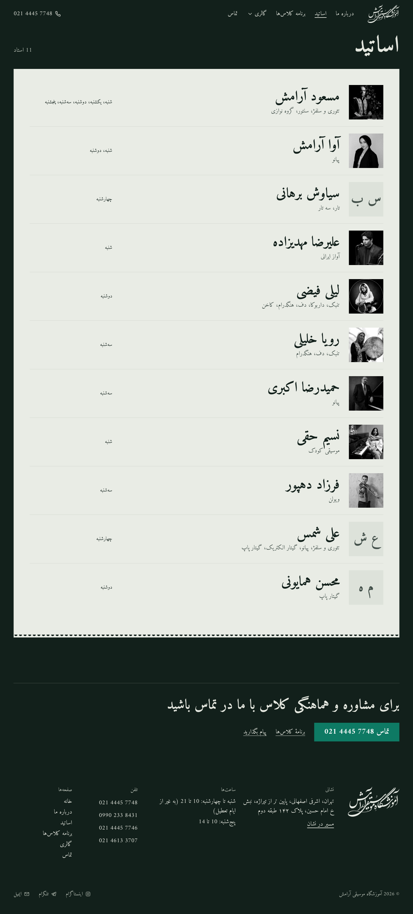 | 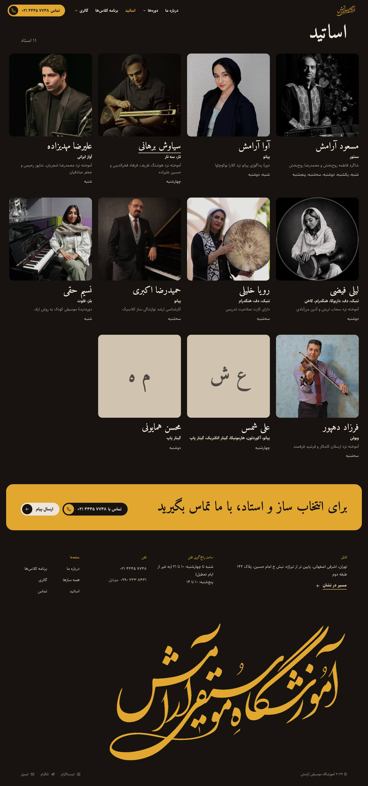 |
| 768 |  | 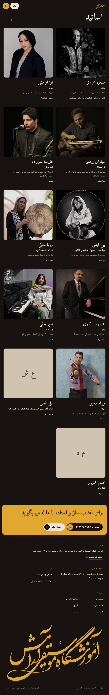 |
| 390 |  | 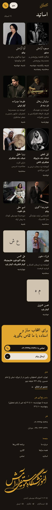 |

The hero mid-crossfade is in `screenshots/step12-motion/`.

## 7. Mobile that's designed, not shrunk

**Verdict: met; not yet tried on a real phone.**

- **Navigation:** the logo, «منو» and a round saffron call button that never leaves the screen; «منو» opens a full-screen sheet whose page list scrolls while call and route stay put.
- **Schedule:** day tabs, with today open before first paint (no layout shift); the desktop grid is a separate design.
- **Browsing:** teachers and Programmes become sideways rails with the next card peeking; Instrument and session tiles pair up, one per row on the narrowest phones; the lightbox swipes.
- **Contact form:** fields at 16px or more (no zoom), `tel`/`email` keyboards, `autocomplete`, and «ارسال» on the keyboard's return key. Phone is required; email and subject are optional.
- **Phone details:** safe-area padding for the notch and home indicator, `svh`/`dvh` heights, no tap highlight, and hover effects only on devices that hover.
- **Checked by:** `/mobile-native` (step 13), `/break-ui` at 320px and with large text (step 19).

| Width | Before | After |
|---|---|---|
| 1440 | 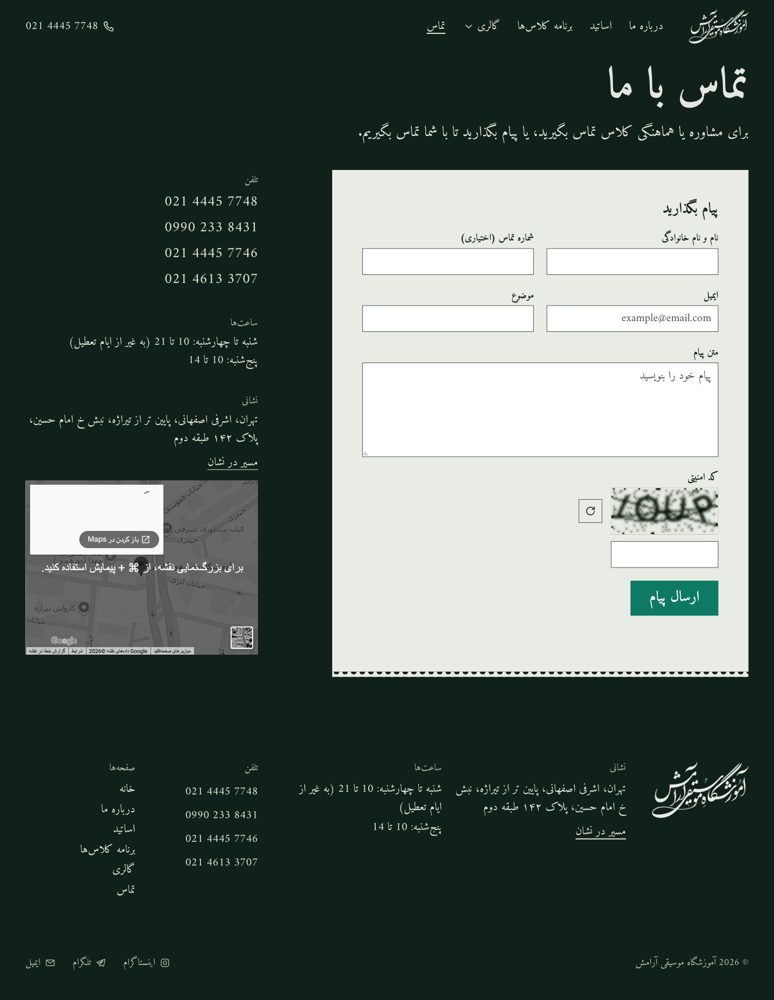 | 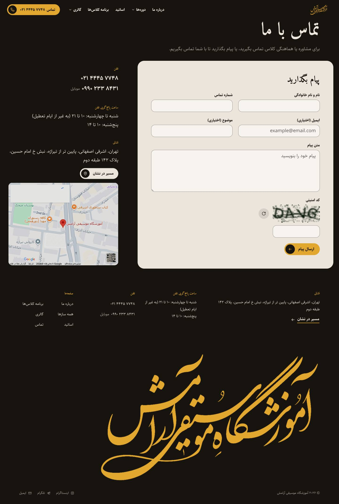 |
| 768 |  | 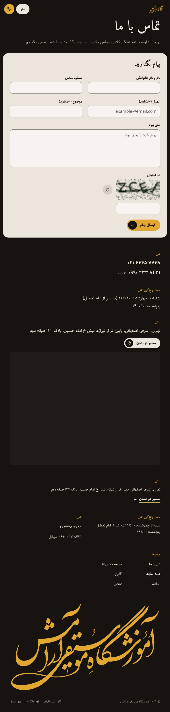 |
| 390 |  | 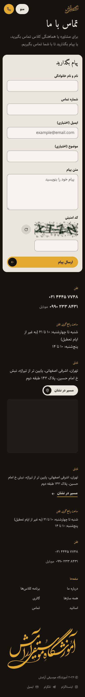 |

## 8. The invisible expensive stuff

**Verdict: met; one page misses the LCP target on slow 4G at a phone's pixel density (see the measurements).**

- **Accessibility:**
  - axe-core 4.10.2 (WCAG 2.0–2.2 A/AA and best practice) finds **no violations** on 15 pages at 1440 and 390;
  - every focus ring measures at least 3:1 against what's behind it;
  - the keyboard reaches everything in RTL reading order, with a skip link first;
  - Escape closes every overlay and returns focus.
- **Semantics and meta:**
  - all four landmarks and one `h1` on every page;
  - `lang="fa" dir="rtl"`;
  - a title, description, canonical and Open Graph tags from `SITE_DOMAIN`, and a sitemap that leaves out the hidden hero album.
- **Forms:** labelled fields, an error summary that links each field, messages tied to their inputs with `aria-describedby`, and django-simple-captcha. A mail failure never blocks the Visitor.
- **No console errors** on 43 pages × 3 widths with `DEBUG=False`, and no 4xx apart from the deliberate 404.
- **Hardened:** worst-case data (long names at the models' limits, six Instruments, one testimonial, empty albums) breaks nothing, and nothing scrolls sideways from 320 to 1440 or at 200% text ([break-ui-step19.md](break-ui-step19.md)).

| Width | Before (404) | After (404) | After (message sent) |
|---|---|---|---|
| 1440 | 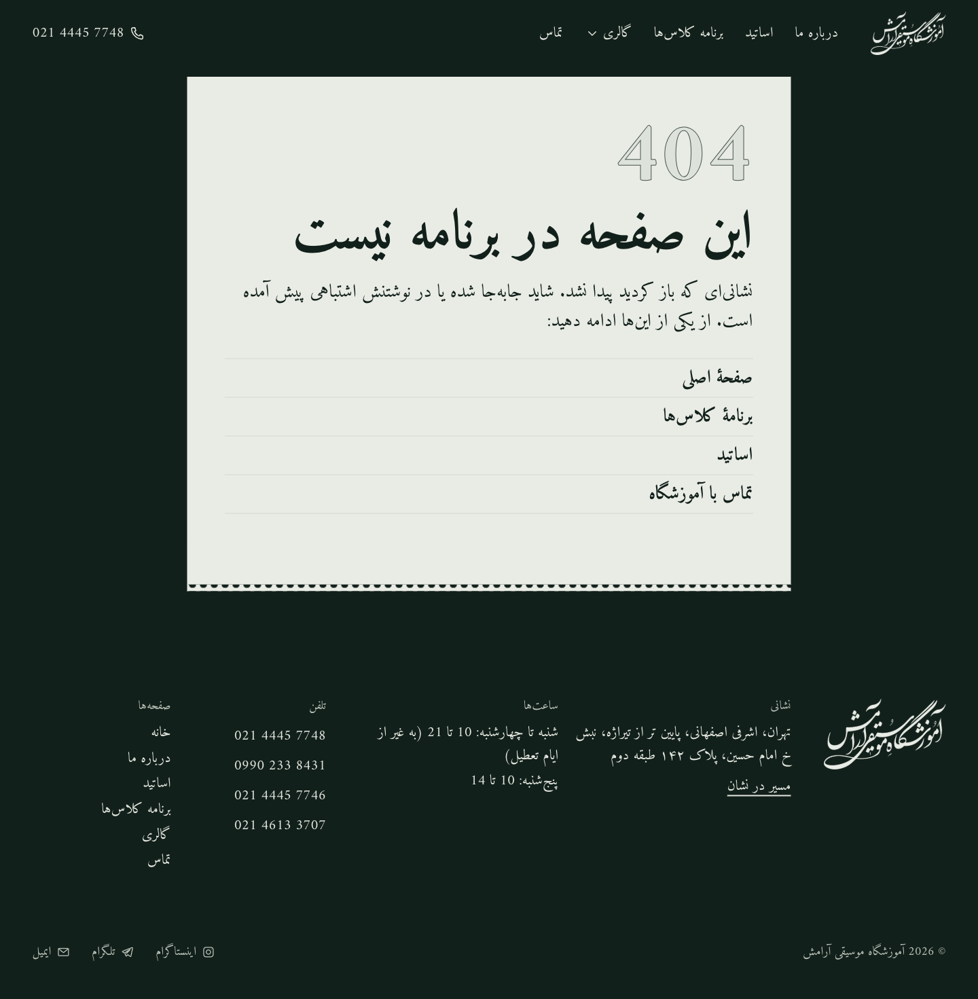 | 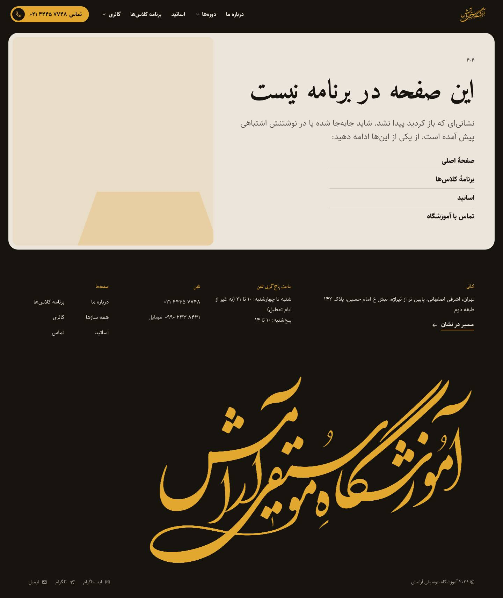 | 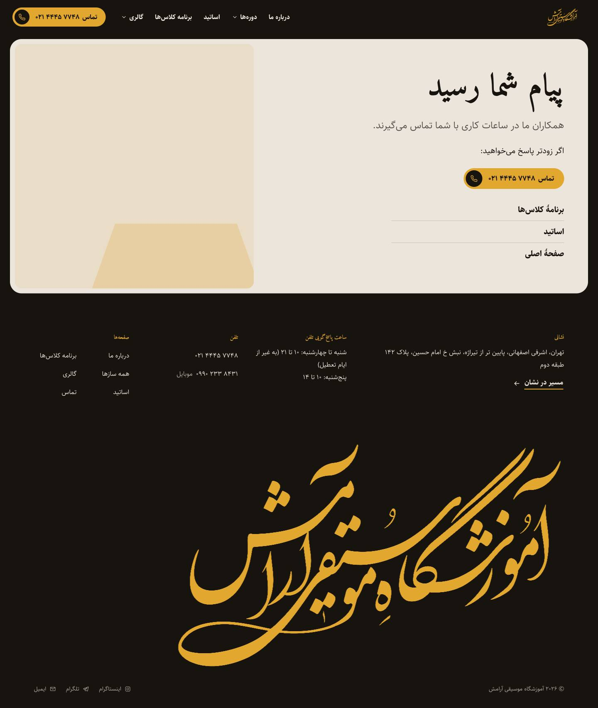 |
| 768 |  | 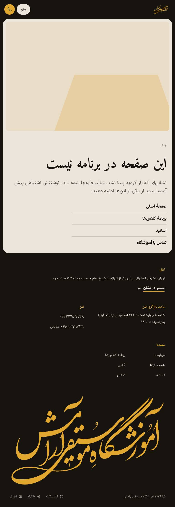 | 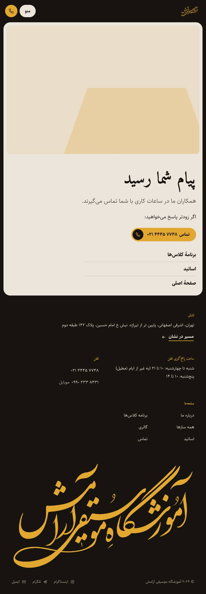 |
| 390 |  | 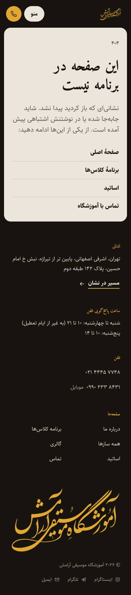 | 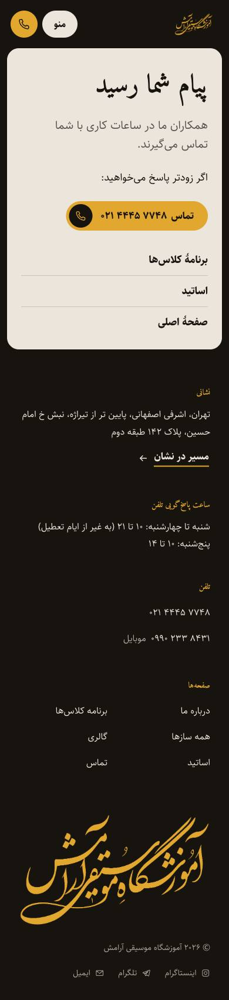 |

---

## Measurements

Measured on 2026-10-27 at 390×844 against the `DEBUG=False` server, with the cache off and Chrome's network throttling (fast 4G: 9 Mb/s, 60 ms; slow 4G: 1.6 Mb/s, 150 ms). Transfer is what the page fetches by `load` plus 2s. "Before" is the first measurement, when every page sent each photo at its stored size; "after" is with the smaller copies (see below). The 3× column is the same slow 4G run at a phone's pixel density, which picks larger copies.

| Page | LCP, fast 4G | LCP, slow 4G (before → after) | LCP, slow 4G at 3× | CLS | Transfer (before → after) |
|---|---|---|---|---|---|
| Home | 0.37s | 2.61s → **1.56s** | 1.89s | 0.005 | 603 → 345 KB |
| Teachers | 0.39s | 2.04s → **1.35s** | 1.64s | 0.004 | 666 → 296 KB |
| Schedule | 0.28s | 0.82s → 0.82s | 0.82s | 0.005 | 259 → 252 KB |
| A Programme (children) | 0.29s | 0.77s → 0.77s | 0.76s | 0.004 | 276 → 212 KB |
| An Instrument (santur) | 0.38s | 1.55s → 1.25s | 1.44s | 0.004 | 254 → 208 KB |
| Contact | 0.30s | 0.76s → 0.77s | 0.75s | 0.004 | 209 → 201 KB |
| Rooms album | 0.80s | 5.76s → **1.32s** | **2.55s** | 0.004 | 2,266 → 367 KB |

The 2s target now holds on fast and slow 4G for every page. The one miss is the rooms album on slow 4G at 3×: two columns of photos each want an 800px copy there (887 KB in all). Before step 17 the home page took 4.9s on slow 4G, because it loaded all four hero slides at once.

**How the copies work.** Every uploaded photo a page shows (the hero, portraits, gallery photos and covers, Programme and Instrument photos) is offered as WebP at 320, 480, 800 and 1200px wide, up to its own width, through `srcset` and a `sizes` that states how wide the page draws it. The copies are made the first time a page asks for them and kept under `public/media/sizes/`; a copy older than its photo is made again, so a photo replaced in the admin never shows stale. A copy that can't be made is left out and the stored JPEG still shows (`apps/core/image_utils.py`, the `srcset` tag in `site_tags.py`). The lightbox still opens the stored photo.

## Known gaps

- **The album at a phone's pixel density.** The rooms album takes 2.55s on slow 4G at 3×. Lazy-loading fewer photos above the fold, or a smaller `sizes` for its two columns, would bring it under 2s.
- **Not tried on a real phone.** Sticky hover, the landscape notch, the home-indicator inset and the keyboard's return key were checked only in emulation.
- **Code-review items not yet done** ([code-review-step21.md](code-review-step21.md)):
  - CONTEXT.md avoids the words "offering" and "Album", but the code uses them;
  - the image-on-save steps are repeated in six `save()` methods;
  - `instruments_shown == ALL` stands in for "private lessons".
- **Photos.** The hero photos (941–1,280px wide) look soft in the 1,392px frame at 1440, and teacher portraits mix black-and-white and colour.
- **Thin pages.** A page with one teacher or one session tile, such as موسیقی کودک, leaves its row mostly empty on a wide screen until there is more content.
- **The schedule's time ranges** read left to right in the desktop grid («۱۲:۰۰ – ۲۱:۰۰»), a pass-1 choice kept as is.

## What the owner must do in the admin

**After deploying,** run `python manage.py migrate`. It moves تئوری و سلفژ, گروه نوازی and موسیقی کودک from Instrument to Programme, and adds the new fields: Programme, FAQ, Instrument's fields, `lineage`, phone required, and email and subject optional. Then, in the admin:

1. **Photos of students playing** solo, in ensembles and at concerts: one gallery page per concert under کنسرت‌ها, plus گروه نوازی. Until then those albums show their empty state.
2. **Choose the hero photos** in the hidden gallery page `home-hero`, four to six of them, wider than 1200px if possible. Each photo's title becomes the slide's small text.
3. **Instruments:** add a photo and a short overview to each. A tile switches from text-only to its photo by itself.
4. **Programmes:** add photos (up to three each; they crossfade on the card) and age labels (about 20 characters, such as «از ۷ سال»).
5. **Real testimonials** from parents. The section appears once there is one, and starts moving once there are four.
6. **FAQ entries.** Tick "show on home" for the home page, and link each to its Programmes.
7. **The «شیوهٔ آموزش» and «سه قدم» rows** (`teaching` and `first_lesson` in page content), with the approved copy, so they can be edited.
8. **Ali Shams and Mohsen Homayouni:** a biography and a portrait each. Until then the site hides the «.» biography and shows their initials.
